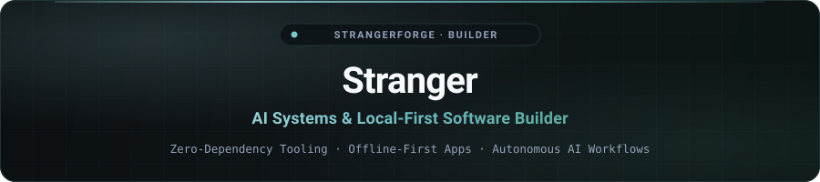

<picture>
  <source media="(prefers-color-scheme: dark)" srcset="./assets/header-dark.svg" />
  <source media="(prefers-color-scheme: light)" srcset="./assets/header-light.svg" />
  
</picture>

 

🇬🇧 **English** · 🇹🇷 [**Türkçe**](https://github.com/strangerforge/strangerforge/blob/main/README.tr.md)

 

&nbsp;&nbsp;&nbsp;

---

### 🚀 About Me

I focus on building **calm, auditable software that runs locally and stays out of your way**—from stdlib-only AI agent infrastructure to offline-capable cross-platform apps and autonomous editorial pipelines.

- **Current Focus:** Evolving [Engramkeep](https://github.com/strangerforge/engramkeep) (`v1.2` stable) for multi-agent Markdown memory, alongside offline-first Capacitor/PWA apps and automated news workflows.
- **Engineering Standards:** Zero unnecessary dependencies, strict static typing & automated verification gates, transparent flat-file storage, and security-by-default boundaries.
- **Collaboration:** Feedback, bug reports, and architecture ideas are always welcome via [Issues](https://github.com/strangerforge/engramkeep/issues) and [Discussions](https://github.com/strangerforge/engramkeep/discussions).

---

### 🌟 Featured Projects

<table width="100%">
  <tr>
    <td width="125" align="center" valign="top">
      <a href="https://github.com/strangerforge/engramkeep"><picture><source media="(prefers-color-scheme: dark)" srcset="https://raw.githubusercontent.com/strangerforge/engramkeep/main/assets/logo-dark.svg" /></picture></a>
       
      <b>● Open Source</b>
    </td>
    <td valign="top">
      <h3>🧠 Engramkeep — Persistent Markdown Memory &amp; Fix Registry for AI Agents</h3>
      

        &nbsp;&nbsp;&nbsp;
      

      

        <b>Stable local-first Python CLI, MCP server (tools, resources &amp; prompts), and modular dashboard</b> giving 10 AI coding agents layered project + global Markdown memory — with budget-bounded <code>context</code> packing, ADR lifecycle, BM25 bilingual search, SHA-256 audit chain, optional encryption, and allowlist Git sync. Install: <code>pipx install engramkeep</code>
      

      

        &nbsp;&nbsp;
      

    </td>
  </tr>
</table>

 

<table width="100%">
  <tr>
    <td width="125" align="center" valign="top">
      
       
      <b>● Release Hub</b>
    </td>
    <td valign="top">
      <h3>🌿 Niyaz — Offline-First Prayer Times, Quran &amp; Daily Companion</h3>
      

        &nbsp;&nbsp;&nbsp;
      

      

        <b>100% offline, ad-free</b> modern Islamic daily companion combining accurate prayer times, 3D Qibla compass, multi-translation Quran reader, smart tasbih counter, and curated duas in one serene cross-platform app.
      

      

        &nbsp;&nbsp;
      

    </td>
  </tr>
</table>

 

<table width="100%">
  <tr>
    <td width="125" align="center" valign="top">
      <a href="https://aigunluk.vercel.app"><picture><source media="(prefers-color-scheme: dark)" srcset="https://aigunluk.vercel.app/icons/icon-dark.svg?v=4" /></picture></a>
       
      <b>● Live Platform</b>
    </td>
    <td valign="top">
      <h3>📰 AI Günlük — Autonomous AI News Radar &amp; Turkish Briefings</h3>
      

        &nbsp;&nbsp;&nbsp;
      

      

        <b>Fully automated Swiss-editorial AI news &amp; signal aggregator</b> scanning global and Turkish AI ecosystems 24/7, extracting full articles and distilling updates into dense 5–7 sentence Turkish (TR) daily briefings.
      

      

        &nbsp;
      

    </td>
  </tr>
</table>

---

### 🛠️ Tech Stack & Arsenal

  <picture>
    <source media="(prefers-color-scheme: dark)" srcset="https://skillicons.dev/icons?i=python%2Cts%2Cjs%2Cnodejs%2Csqlite%2Chtml%2Ccss%2Ctailwind%2Cgit%2Cgithub%2Cgithubactions%2Cvercel%2Cfigma&theme=dark" />
    <source media="(prefers-color-scheme: light)" srcset="https://skillicons.dev/icons?i=python%2Cts%2Cjs%2Cnodejs%2Csqlite%2Chtml%2Ccss%2Ctailwind%2Cgit%2Cgithub%2Cgithubactions%2Cvercel%2Cfigma&theme=light" />
    
  </picture>

 

- **Core & Runtimes:** Python 3.10–3.14 (stdlib-first CLI & servers), TypeScript / JavaScript (ES6+), Node.js, Capacitor (iOS / Android)
- **AI Tooling & Quality:** MCP (Model Context Protocol), PyPI Trusted Publishing (OIDC), `pytest`, `mypy`, `ruff`
- **Architecture:** Local-First Flat-Data (Markdown / JSON), Progressive Web Apps (PWA), Service Workers, Autonomous Cron Pipelines
- **Deployment & Cloud:** PyPI, GitHub Actions, GitHub Releases, Vercel Global Edge CDN

---

*"Simplicity is prerequisite for reliability."* — Edsger W. Dijkstra

Connect &amp; Explore: <a href="https://github.com/strangerforge">@strangerforge</a> · <a href="https://github.com/strangerforge?tab=repositories">Repositories</a> · <a href="https://pypi.org/project/engramkeep/">PyPI (engramkeep)</a> · <a href="https://github.com/strangerforge/engramkeep/discussions">Discussions</a> · <a href="https://github.com/strangerforge/engramkeep/issues">Issues</a>

