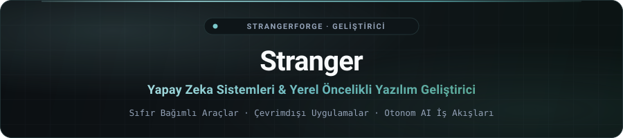

<picture>
  <source media="(prefers-color-scheme: dark)" srcset="./assets/header-dark-tr.svg" />
  <source media="(prefers-color-scheme: light)" srcset="./assets/header-light-tr.svg" />
  
</picture>

 

🇬🇧 [**English**](https://github.com/strangerforge) · 🇹🇷 **Türkçe**

 

&nbsp;&nbsp;&nbsp;

---

### 🚀 Hakkımda

Yerelde çalışan, **sade, denetlenebilir ve kullanıcıyı yormayan yazılımlar** üretmeye odaklanıyorum — sıfır bağımlılıklı yapay zeka ajan altyapılarından çevrimdışı çalışan mobil/web uygulamalarına ve otonom editoryal veri hatlarına kadar.

- **Güncel Odak:** Çoklu ajan Markdown hafızası sunan [Engramkeep](https://github.com/strangerforge/engramkeep/blob/main/README.tr.md) (`v1.2` kararlı sürüm), çevrimdışı öncelikli Capacitor/PWA uygulamaları ve otonom haber iş akışları.
- **Mühendislik Standartları:** Gereksiz bağımlılık yok, sıkı statik tip kontrolü ve otomatik test kapıları, şeffaf düz-dosya (Markdown/JSON) veri saklama ve varsayılan olarak güvenli sınırlar.
- **İş Birliği:** Hata bildirimleri, mimari fikirler ve katkılar için [Issues](https://github.com/strangerforge/engramkeep/issues) ve [Discussions](https://github.com/strangerforge/engramkeep/discussions) sekmeleri her zaman açıktır.

---

### 🌟 Öne Çıkan Projeler

<table width="100%">
  <tr>
    <td width="125" align="center" valign="top">
      <a href="https://github.com/strangerforge/engramkeep/blob/main/README.tr.md"><picture><source media="(prefers-color-scheme: dark)" srcset="https://raw.githubusercontent.com/strangerforge/engramkeep/main/assets/logo-dark.svg" /></picture></a>
       
      <b>● Açık Kaynak</b>
    </td>
    <td valign="top">
      <h3>🧠 Engramkeep — Yapay Zeka Ajanları için Kalıcı Markdown Hafıza &amp; Çözüm Kayıt Defteri</h3>
      

        &nbsp;&nbsp;&nbsp;
      

      

        10 yapay zeka kodlama ajanı için katmanlı proje + global Markdown hafızası sunan <b>kararlı yerel-öncelikli Python CLI, MCP sunucusu (tools, resources &amp; prompts) ve modüler panel</b> — bütçe sınırlı <code>context</code> paketleme, ADR karar yaşam döngüsü, BM25 çift dilli arama, SHA-256 denetim zinciri, isteğe bağlı şifreleme ve allowlist Git senkronizasyonuyla. Kurulum: <code>pipx install engramkeep</code>
      

      

        &nbsp;&nbsp;
      

    </td>
  </tr>
</table>

 

<table width="100%">
  <tr>
    <td width="125" align="center" valign="top">
      
       
      <b>● Sürüm Merkezi</b>
    </td>
    <td valign="top">
      <h3>🌿 Niyaz — Çevrimdışı Namaz Vakitleri, Kur'an &amp; Günlük Yol Arkadaşı</h3>
      

        &nbsp;&nbsp;&nbsp;
      

      

        <b>%100 çevrimdışı ve reklamsız</b> modern manevi yol arkadaşı. Konuma duyarlı namaz vakitleri, 3D kıble pusulası, Kur'an-ı Kerîm okuyucu, akıllı zikirmatik ve seçkin dualar tek bir huzurlu uygulamada.
      

      

        &nbsp;&nbsp;
      

    </td>
  </tr>
</table>

 

<table width="100%">
  <tr>
    <td width="125" align="center" valign="top">
      <a href="https://aigunluk.vercel.app"><picture><source media="(prefers-color-scheme: dark)" srcset="https://aigunluk.vercel.app/icons/icon-dark.svg?v=4" /></picture></a>
       
      <b>● Canlı Platform</b>
    </td>
    <td valign="top">
      <h3>📰 AI Günlük — Otonom Yapay Zeka Haber Radarı &amp; Türkçe Özetler</h3>
      

        &nbsp;&nbsp;&nbsp;
      

      

        Küresel ve Türkiye yapay zeka ekosistemini 7/24 tarayan, makalelerin tam metnini analiz ederek 5–7 cümlelik yoğun Türkçe günlük bültenlere dönüştüren, <b>İsviçre tipografisi ve minimalist editoryal tasarımlı tam otonom haber platformu</b>.
      

      

        &nbsp;
      

    </td>
  </tr>
</table>

---

### 🛠️ Teknoloji Yığını

  <picture>
    <source media="(prefers-color-scheme: dark)" srcset="https://skillicons.dev/icons?i=python%2Cts%2Cjs%2Cnodejs%2Csqlite%2Chtml%2Ccss%2Ctailwind%2Cgit%2Cgithub%2Cgithubactions%2Cvercel%2Cfigma&theme=dark" />
    <source media="(prefers-color-scheme: light)" srcset="https://skillicons.dev/icons?i=python%2Cts%2Cjs%2Cnodejs%2Csqlite%2Chtml%2Ccss%2Ctailwind%2Cgit%2Cgithub%2Cgithubactions%2Cvercel%2Cfigma&theme=light" />
    
  </picture>

 

- **Çekirdek & Çalışma Zamanları:** Python 3.10–3.14 (stdlib öncelikli CLI & sunucular), TypeScript / JavaScript (ES6+), Node.js, Capacitor (iOS / Android)
- **AI Araçları & Kalite:** MCP (Model Context Protocol), PyPI Trusted Publishing (OIDC), `pytest`, `mypy`, `ruff`
- **Mimari:** Yerel Öncelikli Düz Veri (Markdown / JSON), Progressive Web Apps (PWA), Service Workers, Otonom Cron Hatları
- **Dağıtım & Bulut:** PyPI, GitHub Actions, GitHub Releases, Vercel Global Edge CDN

---

*"Sadelik, güvenilirliğin ön koşuludur."* — Edsger W. Dijkstra

Bağlantılar: <a href="https://github.com/strangerforge">@strangerforge</a> · <a href="https://github.com/strangerforge?tab=repositories">Repolar</a> · <a href="https://pypi.org/project/engramkeep/">PyPI (engramkeep)</a> · <a href="https://github.com/strangerforge/engramkeep/discussions">Discussions</a> · <a href="https://github.com/strangerforge/engramkeep/issues">Issues</a>

